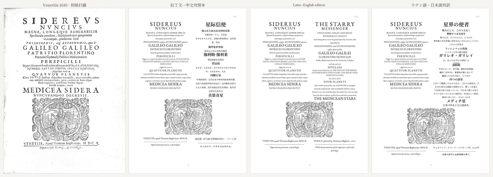
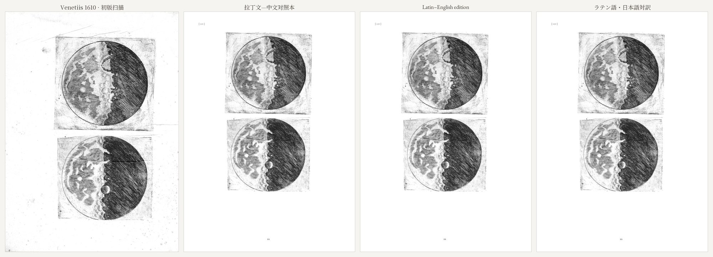
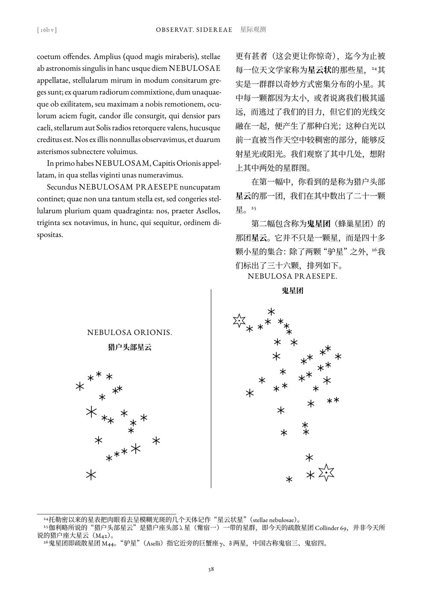
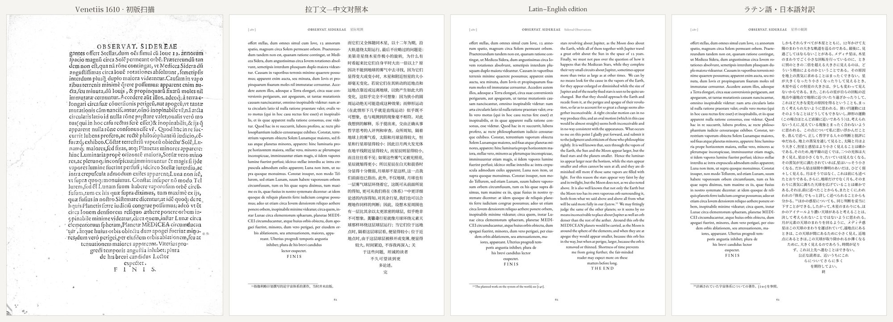
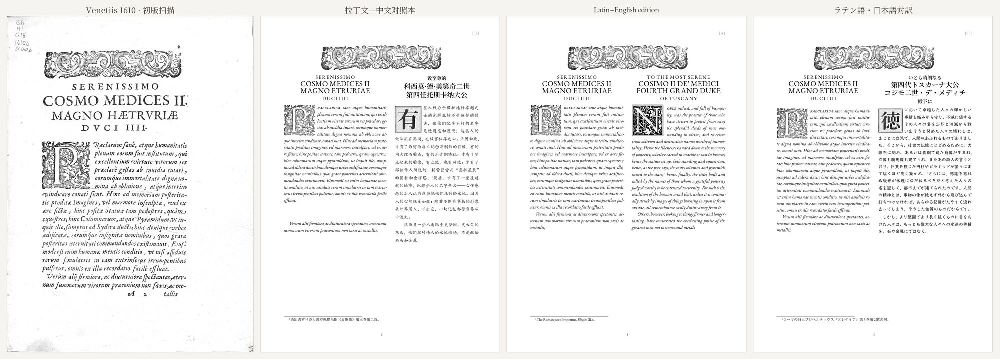

*English version: [Re-typesetting a book from 1610](/post/sidereus-nuncius-en/)*

1610 年 3 月，伽利略在威尼斯出了一本薄薄的小书，《星际信使》（*Sidereus Nuncius*）。他把自己磨制的望远镜对准天空，发现月亮表面不是光滑的，而是布满山峦和凹坑；银河是无数恒星聚成的；木星身边还有四颗从没有人见过的小星，每晚换一个位置。这本六十来页的小册子，动摇了一个维持了两千年的天空。

前阵子我在 Internet Archive 上翻到了史密森学会图书馆藏的初版扫描。看着那些木刻首字母和月面铜版画，我冒出一个念头：能不能用现代的排版技术，把它原样重排一遍，再配上翻译？

这件事最后变成了一个和 Claude（Anthropic 的 AI）合作的长项目。成品放在 GitHub 上：[metachow/sidereus-nuncius](https://github.com/metachow/sidereus-nuncius)，PDF 在 [Releases](https://github.com/metachow/sidereus-nuncius/releases) 里可以直接下载。

## 做成了什么样

一句话：**每一页对应 1610 年初版的一页**。左栏是现代拼写的拉丁文，断页的位置和初版完全一致；右栏是直接从拉丁文译出的新译文。现在有三个版本：拉丁文—中文、拉丁文—英语，以及拉丁文—日语（『星界の使者』）。

下面是书名页。左起：初版扫描、中文版、英语版、日语版。

初版用了好几种字体：罗马体、带花式大写的意大利斜体、字距拉开的大写字母，还有大号的标题大写。重排时每一种都对应了下来。拉丁文用 EB Garamond（一款复刻 16 世纪 Garamond 的字体），中文用宋体、楷体（对应斜体）和粗体（对应大写强调），日语则是明朝体、教科书体和傍点。

## 从扫描开始

第一个坑是扫描本身。Internet Archive 默认给的 PDF 用了 MRC 压缩，文字还算清楚，铜版画的细密排线却被压成了一团。换成他们存档里的原始 JP2 图像（约 657 dpi）才算有了可用的底子。

去黄没有用什么花哨的方法：给纸张的颜色拟合一个平滑的曲面，再除掉它，墨色就留下来了。我们刻意**没有用 AI 超分辨率**处理铜版画。AI 会"脑补"出看起来更清楚、但伽利略的刻工从没刻过的线条，对一本复刻本来说，这比模糊更糟。几幅月面图上有书页的折痕，是从邻近的完好区域拷贝图块补上的。

星图和木星卫星图则是另一种处理：在扫描上逐颗星测量坐标，再用 TikZ 重绘成矢量图。星的数量和伽利略正文里说的一致，旧星画成双线大星、新发现的画成单线小星，也照初版。

## 先有文字，再有页面

一开始我们是直接一页一页手写 LaTeX，很快就发现不好维护：改一句译文，就得找到它落在哪一页的哪个文件里。后来我提议反过来，先拿到文本、翻译好，最后再处理断页，于是改成了"先文字、后页面"：拉丁文按段落和句子编号存进一个 YAML 文件（81 段、315 句），初版的断页用 `⟦8v⟧` 这样的标记标在句子里；译文按同样的编号一句一句存；页面文件由脚本生成，不再手改。

这个结构后来帮了大忙。加英语版、日语版，本质上就是"再翻译 315 句"，排版的事全交给脚本。

## 翻译：AI 翻译，AI 校对

翻译是由 Claude 的子代理完成的：Sonnet 负责翻译，五个代理各管一段，同时进行；Opus 负责校对，逐句对照拉丁文。我们给它们定了一条硬规矩：**直接从拉丁文翻译，不参照任何仍有版权的现代译本**。

校对这一步比我预想的有用得多。日语版校对时，Opus 一共改了大约 140 处实质性错误，比如：

- 献词里一句话的语法关系被理解反了，译成了"木星是一切善的源泉"，原文其实是说神是一切善的源泉，木星仅次于他；
- 有一句把月亮周围的水汽层说成"自己发光"，原文是"被太阳照亮"，前者恰好和伽利略的论证相反；
- 两处"如上图所示"，图其实在下面。

校对也会提出一些需要编者拍板的问题，比如观测日志里反复出现的格式怎么统一，"观测"和"观察"怎么区分。这些决定统一记在一个裁定文件里，再转给还在工作的其他校对代理。

当然，这三种译文都还没有经过拉丁文专家审校，书名页上也写明了。如果你懂拉丁文，非常欢迎来提 issue。

## 一些我很在意的细节

整个过程中，大部分代码、翻译和排版是 Claude 做的。我做得最多的事情，其实是**看**，然后说"这里不对"。

**倒三角收尾。** 初版最后一页的正文排成一个倒三角，最后几行越来越窄。我问能不能模仿，Claude 写了一个宏，靠反复试排来决定前面有几行满行。第一版的三角形尖端只剩一个被断开的单词碎片，第二版左边对齐了、右边没有，到第三版才让最后一行真正居中。

**中文的首字母。** 拉丁文献词和正文开头用的是初版的木刻首字母；英语栏找到了 TeX Live 自带的装饰首字母字体 Goudy Initialen，构造和文艺复兴时期的木刻首字母一样。中文没有首字母，我们用脚本生成了"木刻风格"的大字：方框、斜线底纹、做旧的墨色和缺损。一开始有的用楷体，字也偏小；后来我注意到拉丁文的装饰字始终是普通的罗马正体，而且撑满边框，于是改成了宋体粗体、放大到占满框内。

**断页。** 英语和拉丁文语序接近，英译可以在初版断页的位置精确断开。日语版第一次排出来时，我翻了几页就发现很多页的右栏开头是一片空白：跨页的句子被整句放在了前一页，后一页的拉丁文续句旁边什么都没有。后来在日语里找到最接近的分句处断开，问题就解决了。

**日语的排版习惯。** 像"噂""靄""論駁"这样的常用汉字表以外的字，第一次出现时加了振假名（ruby）。初版用大写字母强调的词，日语用傍点。日文里的阿拉伯数字改成了等高数字，因为 EB Garamond 默认的旧式数字放在"1610年"里很别扭。

## 回头看

这个项目让我比较意外的是，AI 能做的远不只是翻译。读扫描、量星图坐标、写 LaTeX 宏、调字体、排版面、做 GitHub 发布，它都能做，而且做得相当好。但"这一页看起来不对""这个三角形右边没对齐""这里的空白不该有"这样的判断，还是要靠人去看。分工大概就是这样：它负责把事情做出来，我负责看。

做完之后，我们把整个流程整理成了一个可复用的 skill：扫描去黄、文本先行的数据结构、子代理翻译和校对、排版里踩过的坑。下一本书已经在做了，是李渔的《闲情偶寄》，康熙刻本，竖排、按原刻行款仿刻：[metachow/xianqing-ouji](https://github.com/metachow/xianqing-ouji)。

## 链接

- 源文件：[github.com/metachow/sidereus-nuncius](https://github.com/metachow/sidereus-nuncius)
- PDF 下载：[Releases](https://github.com/metachow/sidereus-nuncius/releases)
- 初版扫描：Smithsonian Libraries，Internet Archive [`Sidereusnuncius00Gali`](https://archive.org/details/Sidereusnuncius00Gali)
- 拉丁文底本：A. Favaro 编《伽利略全集》国家版第三卷（1892）

译文、注释与排版以 CC BY 4.0 发布，脚本以 MIT 发布；拉丁原文和初版扫描属公有领域。
